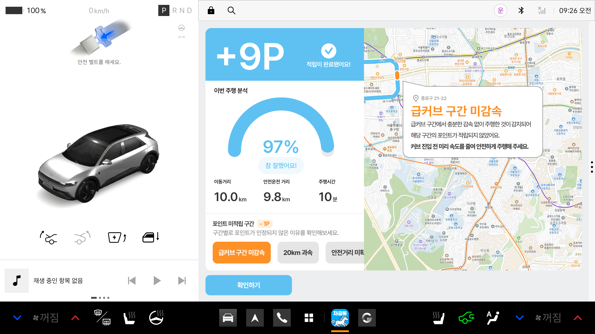
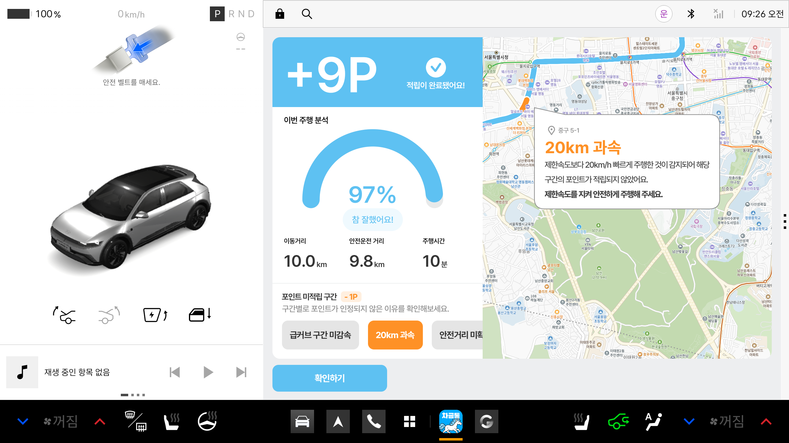
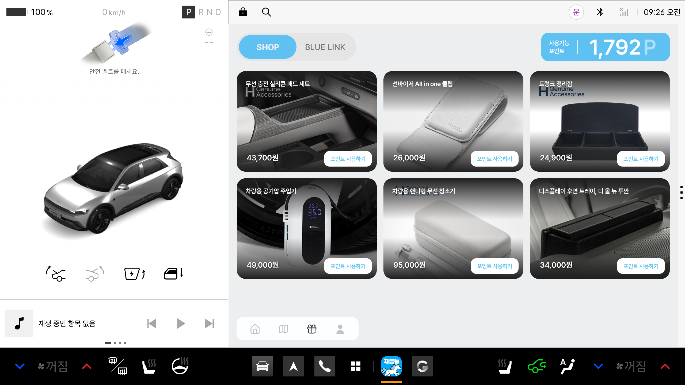
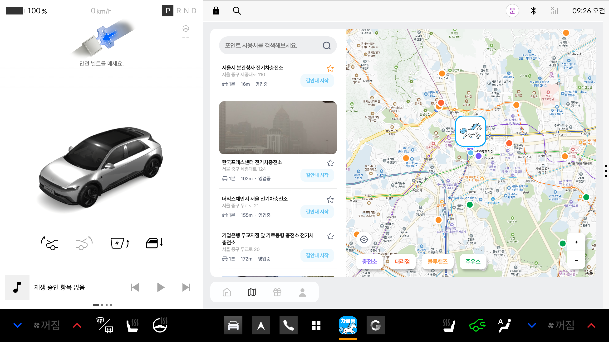
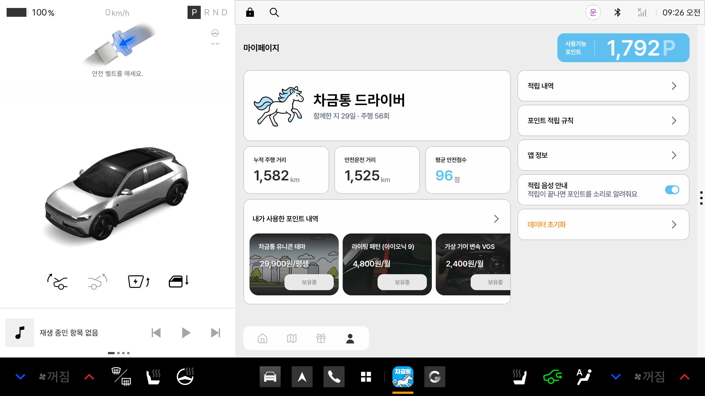
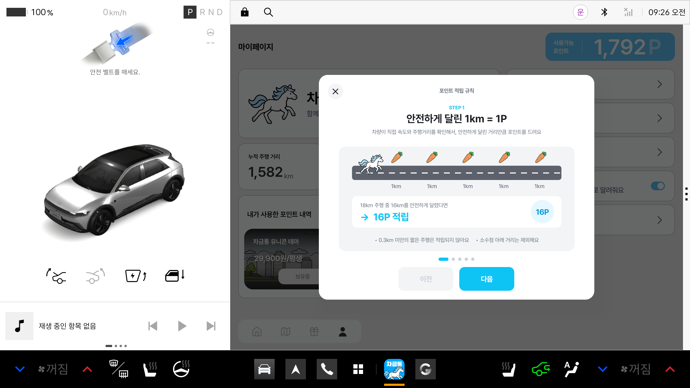
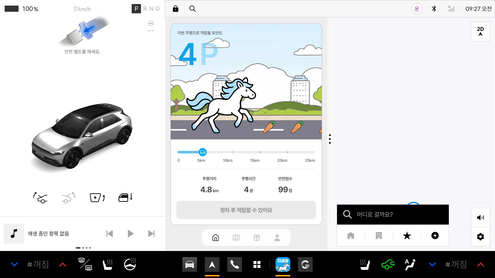

<div align="center">

# 🥕 차금통

**안전하게 달린 거리만큼 쌓이는 차 안의 저금통**

팀 **삼남매** · Pleos Connect 차량용 앱 개발 공모전 출품작


</div>

## 한눈에 보기

주행이 끝나면 이번 주행을 분석해 **안전하게 달린 거리 1km당 1포인트**를 적립합니다. 위험 운전이 감지된 구간은 빠지고, 모은 포인트로 차량 기능·테마·용품을 사거나 근처 사용처로 길안내를 받습니다. 당근(포인트)을 먹으며 달리는 유니콘이 주행을 함께합니다.

| | |
|---|---|
| 📦 **APK** | [`apk/삼남매_차금통_release.apk`](apk/삼남매_차금통_release.apk) |
| 🖥️ **테스트 환경** | Pleos Connect Emulator v2.1.0 · Android API 34 · 2560×1440 / 160dpi |
| 🚗 **Pleos SDK** | Vehicle SDK 2.3.2 · NaviHelper SDK 3.0.5 · TextToSpeech SDK 3.3.1 |
| ▶️ **바로 보기** | 앱 실행 → 홈 오른쪽 위 **▶ 데모 주행** → 약 40초 뒤 **[주행 분석하고 적립하기]** |

## 핵심 기능

### 1. 실시간 주행 적립
- 기어 **D**로 출발하면 이동 거리와 **이번 주행으로 적립될 포인트**가 실시간으로 올라갑니다.
- 유니콘이 길 위의 당근을 **포인트가 오를 때마다 하나씩** 먹고, 과속하면 배경이 빨라지고 급정거하면 몸이 젖혀집니다.
- 진행 레일에 미적립 구간이 주황색으로 표시됩니다.

### 2. 주행 분석
- 정차(**P**) 후 **[주행 분석하고 적립하기]** → 안전운전 비율, 이동·안전운전 거리, **미적립 구간과 그 이유**를 카카오맵 경로 위에 보여줍니다.
- 위반 때문에 못 받은 포인트를 **"- nP" 태그**로 바로 알려줍니다.
- 적립이 끝나면 TTS로 "이번 주행으로 N포인트가 적립됐어요"를 읽어줍니다.

### 3. 포인트 사용
- **상점**: 블루링크 차량 기능 구독·테마(BLUE LINK), 차량 용품(SHOP)을 포인트로 구매합니다.
- **지도**: 주변 전기차 충전소·현대자동차 지점·블루핸즈·현대오일뱅크를 찾아 **NaviHelper로 길안내**합니다.
- **마이페이지**: 누적 주행·안전점수, **내가 사용한 포인트 내역**(보유 상품), 포인트 적립 규칙 5단계 안내.

### 4. 차 안에서 쓰기 좋게
- **주행 중 제한**: 주행 중에는 적립·구매·검색 입력을 막고 광고 자동 넘김을 멈춥니다. 정차 중 열어 둔 구매 창·검색어도 출발하면 자동으로 닫히고 비워집니다.
- **분할 화면**: 옆에 내비 등 다른 앱을 같이 띄워 앱 폭이 절반(840)이 되면 세로 배치로 바뀝니다.
- **주행 위젯**: 다른 앱으로 가도 화면 아래 "이번 주행 포인트" 위젯에서 유니콘이 달립니다. 끌어서 옮기고, 누르면 차금통으로 돌아옵니다.
- **알림**: 주차(P) 2초 뒤 적립 안내, 적립하지 않고 다시 출발하려 하면 "잊어버린 포인트" 안내. 앱 안 팝업과 시스템 알림 센터에 함께 남습니다.
- **가독성**: 터치 영역 최소 76dp, Pleos UI 가이드 Typography 하한 이상.

## 화면

| 홈 (대기) | 주행 중 |
|---|---|
|  |  |
| **주행 분석** | **미적립 구간 선택** |
|  |  |
| **상점** | **지도 · 길안내** |
|  |  |
| **적립 내역** | **마이페이지** |
|  |  |
| **포인트 적립 규칙** | **분할 화면 (내비와 함께)** |
|  |  |

## 실행 방법

1. **APK 설치**
   ```
   adb install -r apk/삼남매_차금통_release.apk
   ```
2. 앱 목록에서 **차금통** 실행 → 차속 권한(위치 정보로 표시됨)과 알림 권한을 **허용**합니다.
3. 홈 오른쪽 위 **▶ 데모 주행** → 약 40초 동안 10km 데모 경로를 주행합니다.
4. 주행이 끝나면 **[주행 분석하고 적립하기]** → 미적립 칩을 눌러 이유 확인 → **[확인하기]** → 총 포인트가 늘어난 것을 확인합니다.

> **주행 위젯**은 '다른 앱 위에 표시' 권한이 필요합니다. Pleos 에뮬레이터엔 이 설정 화면이 없어 설치 후 한 번 아래 명령으로 허용합니다 (허용하지 않으면 위젯만 안 뜨고 나머지는 그대로 동작).
> ```
> adb shell appops set com.pure.chageumtong SYSTEM_ALERT_WINDOW allow
> ```

> **데모 데이터 초기화**: 마이페이지 → 데이터 초기화 (또는 홈의 "총 적립 포인트" 제목 길게 누르기) → 시드 데이터(14,560P, 지난 4주 출퇴근 주행). 홈의 거리·적립 통계는 최근 30일 기준입니다.

### 실제 차량 신호로 테스트 (Virtual Console)

에뮬레이터가 user 빌드라 `adb root`·`inject-vhal-event`를 쓸 수 없어, Virtual Console HTTP API로 기어·속도를 바꿉니다. 이 경로는 데모와 달리 **Pleos Vehicle SDK·Car API가 실제로 받은 값**으로 적립합니다.

```
scripts/drive_demo.sh [속도km/h=60] [주행초=40]
# 예) scripts/drive_demo.sh 60 40   → P→D→60km/h 40초→정차→P, 약 0.67km 적립 가능
```

> ⚠️ 앱은 `distractionOptimized`로 선언되어 있지만, Pleos 에뮬레이터는 **스토어가 아닌 adb로 설치한 앱**을 주행 중 허용 목록에서 뺄 수 있습니다 (logcat: `CarPackageManagerService: ... not installed from permitted sources`). 이때 기어 D·5km/h 이상에서 "주행 중에는 사용할 수 없습니다"가 앱을 가립니다. 앱 기능 확인은 기어가 P로 유지되는 **▶ 데모 주행**을 권장합니다.

팝업과 주행 위젯은 `scripts/popup_demo.sh`로 단계별로 볼 수 있습니다.

## 테스트 환경

| 항목 | 값 |
|---|---|
| 에뮬레이터 | **Pleos Connect Emulator v2.1.0** (Android Automotive, user 빌드) |
| Android | API 34 |
| 화면 규격 | **2560×1440 / 160dpi**, 가로 · 앱 영역 1682×1210dp (분할 화면 841×1210dp) |
| 빌드 | Kotlin 2.2 · Jetpack Compose(Material3) · AGP 9.5 · minSdk 28 · targetSdk 37 |
| 저장 | DataStore + kotlinx.serialization (앱 내부 저장, 서버 없음) |

## 포인트 적립 규칙

| 단계 | 규칙 |
|---|---|
| 기본 | 안전하게 달린 **1km = 1P** (소수점 아래 제외, 0.3km 미만 주행은 적립 안 됨) |
| 판정 | 교통안전공단 11대 위험운전행동(eTAS): 급출발·급가속 1초에 +11km/h 이상, 급감속·급정지 1초에 −7.5km/h 이상, 과속 = 제한속도 +10km/h 초과 3초 이상, 급커브 미감속 |
| 빠지는 거리 | 위반 지점 앞뒤로 그 속도의 **정지시거**(도로의 구조·시설 기준에 관한 규칙 제24조) 절반씩. 예) 60km/h → 75m |
| 과속 등급 | 도로교통법 시행규칙 별표 28 벌점 구간: +20 이하 = 과속 구간만 · +20~40 = 구간 + 정지시거×2 · +40~60 = 구간 + 정지시거×4 · +60 초과 = **그 주행 0P** |
| 오탐 방지 | 주행당 첫 급감속·급정지 1건은 봐줌(끼어들기 대비), 겹치는 구간은 한 번만 뺌 |

데모 한 바퀴 결과: 10.04km · 급커브 / 20km 과속 / 안전거리 / 급정지 → 미적립 289m · **9P · 97%** (`DemoRouteTest`로 검증)

## 사용한 Pleos SDK

| SDK | 버전 | 용도 |
|---|---|---|
| Vehicle SDK | 2.3.2 | **기어** 상태(P/R/N/D) 실시간 수신 → 주행 시작·종료 판정 |
| Android Car API (`CarPropertyManager`) | 플랫폼 | **차속** `PERF_VEHICLE_SPEED` 수신 (Vehicle SDK 2.3.2에 차속 API가 없어 AAOS 표준 API 사용) |
| NaviHelper SDK | 3.0.5 | 지도 화면 [길안내 시작] → `requestRoute`로 사용처 길안내 (`onRoutingCompleted`/`onError`), 주행 중 `onCurrentRoadSpeedLimit`로 현재 도로 제한속도 수신 |
| TextToSpeech SDK | 3.3.1 | 적립 완료 음성 안내 (`Mode.ON_DEVICE`, 한국어). 미지원·실패 시 조용히 생략 |

## 사용한 외부 API·라이브러리

| 이름 | 버전 | 용도 |
|---|---|---|
| [카카오맵 Android SDK v2](https://apis.map.kakao.com/android_v2/) | 2.15.2 | 지도 화면·분석 화면의 실제 지도, 장소 핀·경로 표시 |
| [카카오 로컬 API](https://developers.kakao.com/docs/latest/ko/local/dev-guide) | v2 | 주변 사용처 검색 (`scripts/fetch_kakao_places.py`로 미리 받아 `assets/places_kakao.json`에 저장) |
| [카카오모빌리티 길찾기](https://developers.kakaomobility.com/) | v1 | 데모 경로 좌표 (`scripts/fetch_kakao_route.py`로 미리 받아 `assets/demo_route.json`에 저장) |
| [Daum 검색 API](https://developers.kakao.com/docs/latest/ko/daum-search/dev-guide) | v2 | 장소 카드 사진 주소 (같은 스크립트로 미리 받음) |
| [Coil](https://github.com/coil-kt/coil) | 2.7.0 | 인터넷 사진 불러오기 (Apache License 2.0) |

카카오 키는 `local.properties`(레포 미포함)에서 읽습니다. 앱에는 **지도용 네이티브 앱 키만** 들어가며(카카오 콘솔에 등록한 패키지명·서명에서만 동작), REST 키는 스크립트 실행용이라 APK에 들어가지 않습니다. 네이티브 키가 없는 빌드는 그림 지도와 시드 장소로 표시됩니다.

## 구조

```
app/src/main/java/com/pure/chageumtong/
├─ domain/   점수·미적립 구간 엔진 (순수 Kotlin, JUnit 테스트)
├─ data/     vehicle(실차·데모 입력원) · navi(길안내·제한속도) · repo(DataStore) · seed
├─ core/     AppContainer(수동 DI) · 알림 · 주행 위젯 오버레이
└─ ui/       theme · components · screens(home·analysis·map·shop·my·history)
```

화면과 점수 엔진은 데이터가 실차에서 왔는지 데모에서 왔는지 모릅니다. 분기는 `VehicleDataSource` 구현체(`PleosVehicleDataSource` / `DemoVehicleDataSource`)에서만 합니다.

## 한계와 계획

- **급커브·안전거리 판정은 데모 경로 기반**입니다. 실차 핸들 각도·ADAS(차간거리) 신호를 받을 수 없어 커브 구간과 안전거리 이벤트는 데모 경로 데이터로 판정합니다. 해당 API가 열리면 `VehicleDataSource`에 입력만 추가해 연동합니다.
- **제한속도**: 실주행은 NaviHelper의 현재 도로 제한속도를 쓰고, 값이 없거나 10초 넘게 갱신이 없으면 60km/h로 판정합니다. 에뮬레이터는 길안내 없이 0을 보내 60km/h 기본값으로 동작합니다.
- **급회전·급U턴·신호위반·중앙선 침범**은 판정하지 않습니다 (신호위반·중앙선은 ADAS SDK 공개 후).
- **지도 위치**: 현재 위치는 시연용 고정 좌표(서울시청)이고, 소요시간은 직선거리를 시속 30km로 환산한 추정치입니다. 내비 앱의 경로 탐색은 네트워크가 필요합니다.
- **분석 지도**: 실주행도 데모 경로 위에 표시합니다.

## APK 위치

`apk/삼남매_차금통_release.apk`

## 이미지·폰트 출처

- 유니콘·도시·당근 일러스트, 아이콘, 적립 규칙 그림: 팀 삼남매 자체 제작
- 광고 배너 차량 사진, 상점 상품 사진(블루링크 기능·현대자동차 정품 액세서리), 카카오 키가 없을 때의 장소 사진: **시연용, 저작권 현대자동차**
- 지도 타일·장소 정보: **ⓒ Kakao** (카카오맵 SDK, 카카오 로컬 API)
- 지도 장소 카드 사진: Daum 이미지 검색 결과의 **주소만 저장하고 실행 중에 불러와 표시**합니다(파일은 레포·APK에 없음). 저작권은 각 원 게시자에게 있으며 공모전 시연 목적으로만 사용합니다.
- 서드파티 캐릭터(IP) 이미지는 사용하지 않습니다.
- 폰트: [Pretendard](https://github.com/orioncactus/pretendard) — SIL Open Font License 1.1 (`docs/PRETENDARD_LICENSE.txt`)
