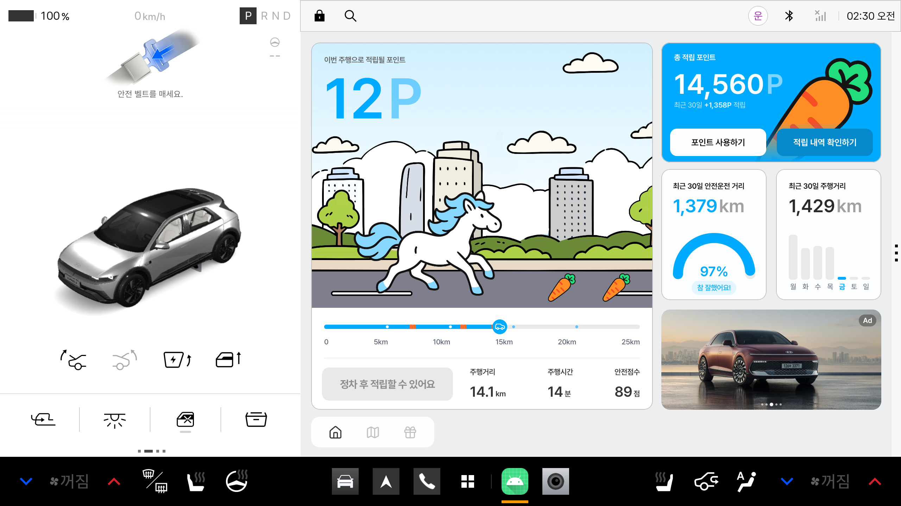
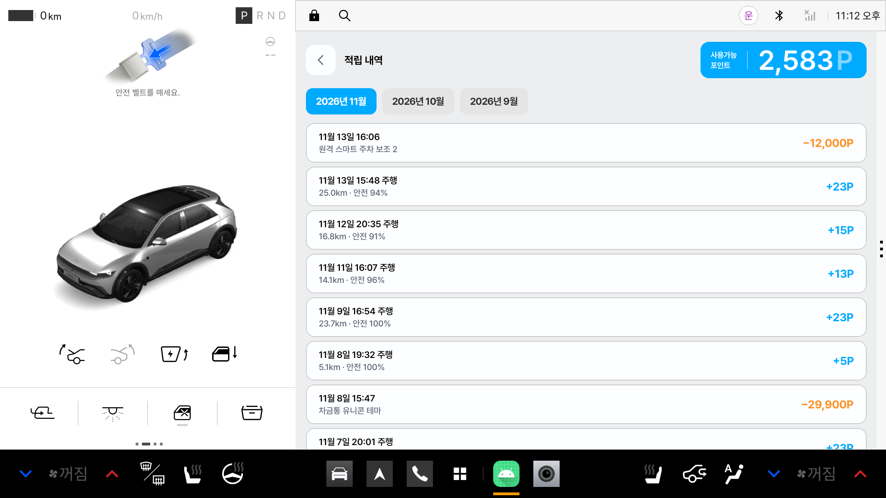

# 차금통 — 안전하게 달린 거리만큼 쌓이는 차 안의 저금통

팀 **삼남매** · Pleos Connect 차량용 앱 개발 공모전 출품작

주행이 끝나면 이번 주행을 분석해 **안전하게 달린 거리 1km당 1포인트**를 적립하고, 그 포인트로 차량 디지털 상품을 사거나 근처 사용처를 찾는 차량용 앱입니다. 당근(포인트)을 먹으며 달리는 유니콘이 주행을 함께합니다.

## 핵심 기능

- **실시간 주행 적립**: 기어 D로 출발하면 이동 거리와 적립 예정 포인트가 실시간으로 올라가고, 진행 레일에 미적립 구간이 표시됩니다.
- **주행 분석**: 정차(P) 후 [주행 분석하고 적립하기]를 누르면 안전운전 비율, 이동·안전운전 거리, 위반 구간(과속·급커브 미감속·안전거리 미확보)과 그 이유를 지도 위에 보여줍니다.
- **포인트 사용**: 상점에서 차량 기능 구독·테마·용품을 포인트로 구매하고, 카카오맵 위에서 주변 전기차 충전소·현대자동차 지점·블루핸즈·현대오일뱅크 사용처를 찾아 길안내합니다.
- **알림 팝업**: 주행이 끝나고 P로 2초 지나면 적립 안내, 적립하지 않고 다시 기어를 바꾸면 "잊어버린 포인트" 안내, N으로 정차해 5초 지나면 광고 보고 5P 추가 적립(움직이면 바로 닫힘).
- **주행 위젯**: 주행 중 내비 등 다른 앱으로 가도 화면 아래에 "이번 주행 포인트" 위젯이 떠 있습니다. 끌어서 옮기고, 누르면 차금통으로 돌아옵니다.
- **주행 중 제한**: 주행 중에는 적립·구매·검색 입력을 막고 광고 자동 넘김을 멈춥니다. 정차 후에만 조작할 수 있습니다. 정차 중 열어둔 구매 창·검색어도 출발하면 자동으로 닫히고 비워집니다.
- **차량 가독성**: 터치 영역 최소 76dp, 글자는 Pleos UI 가이드 Typography 하한(라벨 20 · 문장 26) 이상.

## 화면

| 홈 | 주행 중 |
|---|---|
|  |  |
| **주행 분석** | **미적립 구간 선택** |
|  |  |
| **상점** | **지도** |
|  |  |
| **적립 내역** | |
|  | |

## 실행 방법

1. APK 설치
   ```
   adb install -r apk/삼남매_차금통_release.apk
   ```
   > 설치 직후 기어 D에서 "주행 중에는 사용할 수 없습니다"가 뜨면 위 명령을 한 번 더 실행하세요 (에뮬레이터가 첫 설치 때 `distractionOptimized` 설정을 늦게 반영하는 경우가 있음).
2. 앱 목록에서 **차금통** 실행. 처음 실행 시 차속 권한(위치 정보로 표시됨)을 허용합니다.
3. 홈 오른쪽 위 **▶ 데모 주행** 탭 → 약 90초 동안 25km 데모 경로를 주행합니다.
4. 주행이 끝나면 **[주행 분석하고 적립하기]** → 분석 화면에서 미적립 칩을 눌러 이유 확인 → **[확인하기]** → 총 포인트가 늘어난 것을 확인합니다.

> 주행 위젯은 '다른 앱 위에 표시' 권한이 필요합니다. Pleos 에뮬레이터엔 이 설정 화면이 없어서 설치 후 한 번 아래 명령으로 허용합니다 (허용하지 않으면 위젯만 안 뜨고 나머지는 그대로 동작).
> ```
> adb shell appops set com.pure.chageumtong SYSTEM_ALERT_WINDOW allow
> ```

> 데모 데이터 초기화: 정차 중 홈의 "총 적립 포인트" 제목을 길게 누르면 시드 데이터(14,560P, 지난 4주 출퇴근 주행)로 돌아갑니다. 시드는 초기화한 날짜 기준으로 다시 만들어지므로 시연 직전에 초기화하세요.
>
> 홈의 거리·적립 통계는 **최근 30일** 기준입니다.

### 실차 신호로 테스트 (Virtual Console)

에뮬레이터가 user 빌드라 `adb root`·`inject-vhal-event`를 쓸 수 없어서, 에뮬레이터 Virtual Console HTTP API로 기어·속도를 바꿉니다. 이 경로는 데모와 달리 **Pleos Vehicle SDK·Car API가 실제로 받은 값**으로 적립합니다.

```
scripts/drive_demo.sh [속도km/h=60] [주행초=40]
# 예) scripts/drive_demo.sh 60 40   → P→D→60km/h 40초→정차→P, 약 0.67km 적립 가능
```

## 테스트 환경

| 항목 | 값 |
|---|---|
| 에뮬레이터 | **Pleos Connect Emulator v2.1.0** (Android Automotive) |
| Android | API 34 |
| 화면 | **2560×1440 / 160dpi, 가로 고정** (앱 영역 1682×1210dp) |
| 빌드 | Kotlin 2.2 · Jetpack Compose(Material3) · AGP 9.5 · minSdk 28 · targetSdk 37 |
| 저장 | DataStore + kotlinx.serialization (앱 내부 저장, 서버 없음) |

## 사용한 Pleos SDK

| SDK | 버전 | 용도 |
|---|---|---|
| Vehicle SDK | 2.3.2 | **기어** 상태(P/R/N/D) 실시간 수신 → 주행 시작·종료 판정 |
| Android Car API (`CarPropertyManager`) | 플랫폼 | **차속** `PERF_VEHICLE_SPEED` 수신 (Vehicle SDK 2.3.2에 차속 API가 없어 AAOS 표준 API 사용) |
| NaviHelper SDK | 3.0.5 | 지도 화면 [길안내 시작] → `requestRoute`로 사용처(충전소·대리점·블루핸즈) 길안내. 결과는 `onRoutingCompleted`/`onError`로 받아 실패 시 안내 토스트 |
| TextToSpeech SDK | 3.3.1 | 적립 완료 시 "이번 주행으로 N포인트가 적립됐어요" 음성 안내 (`Mode.ON_DEVICE`, 한국어). 미지원·실패 시 조용히 생략 |

## 사용한 외부 API·라이브러리

| 이름 | 버전 | 용도 |
|---|---|---|
| [카카오맵 Android SDK v2](https://apis.map.kakao.com/android_v2/) | 2.15.2 | 지도 화면의 실제 지도, 장소 핀·현재 위치 마커, 확대·축소 |
| [카카오 로컬 API](https://developers.kakao.com/docs/latest/ko/local/dev-guide) (키워드 검색) | v2 | 주변 전기차 충전소·현대자동차 지점·블루핸즈·현대오일뱅크 (분류별 최대 10곳, 가까운 순). `scripts/fetch_kakao_places.py`로 미리 받아 `assets/places_kakao.json`에 저장 |
| [Daum 검색 API](https://developers.kakao.com/docs/latest/ko/daum-search/dev-guide) (이미지 검색) | v2 | 장소 카드 사진: 장소 이름으로 검색한 첫 번째 이미지의 주소 (같은 스크립트로 미리 받음) |
| [Coil](https://github.com/coil-kt/coil) | 2.7.0 | 인터넷 사진 불러오기 (Apache License 2.0) |

카카오 키는 `local.properties`(레포 미포함)에서 읽습니다. 앱에는 **지도용 네이티브 앱 키만** 들어가며(카카오 콘솔에 등록한 패키지명·서명에서만 동작), REST 키는 스크립트 실행용이라 APK에 포함되지 않습니다. 네이티브 키가 없으면 지도는 기존 정적 지도 그림과 시드 장소로 표시됩니다.

화면과 점수 엔진은 데이터가 실차에서 왔는지 데모에서 왔는지 모릅니다. 분기는 `VehicleDataSource` 구현체(`PleosVehicleDataSource` / `DemoVehicleDataSource`)에서만 합니다.

## 한계와 계획

- **급커브·안전거리 판정은 데모 경로 기반**입니다. 실차에서 핸들 각도·ADAS(차간거리) 신호를 받을 수 없어, 커브 구간과 안전거리 이벤트는 데모 경로 데이터로 판정합니다. 향후 해당 API가 열리면 `VehicleDataSource`에 입력만 추가해 연동합니다.
- **제한속도**: 실주행 시 기본 60km/h로 판정합니다. Phase 2에서 NaviHelper의 현재 도로 제한속도(`onCurrentRoadSpeedLimit`)로 교체합니다.
- **지도 위치**: 현재 위치는 시연용 고정 좌표(서울시청)입니다. 소요시간은 직선거리를 시속 30km로 환산한 추정치이고, 카카오 로컬 API에 영업시간이 없어 모두 "영업중"으로 표시합니다.
- **길안내**: 카카오 키가 없을 때 쓰는 시드 장소 좌표는 시연용 근사값입니다. 내비게이션 앱의 경로 탐색은 네트워크가 필요해서, 에뮬레이터가 오프라인이면 내비 앱이 "경로 탐색 오류"를 띄웁니다.
- **분석 지도**: 실주행도 데모 경로 그림 위에 표시합니다.

## APK 위치

`apk/삼남매_차금통_release.apk`

## 이미지·폰트 출처

- 유니콘·도시·당근 일러스트, 아이콘, 분석 화면 지도 배경: 팀 삼남매 자체 제작
- 광고 배너 차량 사진, 상점 상품 사진(가상 기어 변속·라이팅 패턴·원격 스마트 주차 보조 2·자연/포니 테마), 카카오 키가 없을 때의 지도 장소 사진(충전소·대리점·블루핸즈): **시연용, 저작권 현대자동차**
- 지도 타일·장소 정보: **ⓒ Kakao** (카카오맵 SDK, 카카오 로컬 API). 지도 오른쪽 아래 kakao 로고는 SDK가 표시합니다.
- 지도 화면 장소 카드 사진: **Daum 이미지 검색 결과의 이미지 주소만 저장하고 앱 실행 중에 불러와 표시**하며, 사진 파일은 레포와 APK에 포함되지 않습니다. 저작권은 각 이미지의 원 게시자(블로그·웹사이트 등)에게 있고, 공모전 시연 목적으로만 사용합니다. 검색 결과가 없는 장소는 사진 없이 표시합니다. 상업적으로 배포할 경우 사진은 권리를 확보한 이미지로 교체해야 합니다.
- 사진이 없는 상품은 테마색 그라데이션 카드로 표시합니다. 서드파티 캐릭터(IP) 이미지는 사용하지 않습니다.
- 폰트: [Pretendard](https://github.com/orioncactus/pretendard) — SIL Open Font License 1.1 (`docs/PRETENDARD_LICENSE.txt`)
